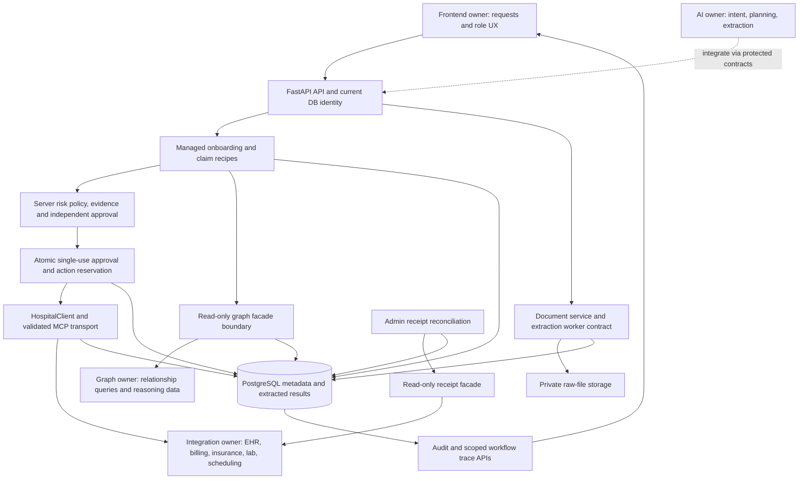
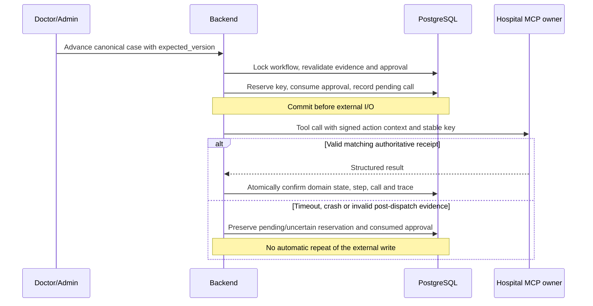

# Backend architecture and integration boundaries

The backend owns authorization and durable truth about workflow progress. The
agent can propose intent, plans or risk, but cannot manufacture an approval,
completion receipt or external identifier. PostgreSQL transactions enforce state
and idempotency before calls leave the process.

## Ownership and trust

- `backend.application:create_app` is the minimal API factory. It initializes
  adapters but performs no migration or external health call at startup. Compose
  handles database health and a separate migration service.
- `auth/security` validates signature, audience, issuer, expiry and token type,
  then checks the active user/current role in the DB. Patients are scoped to owned
  or subject-bound resources. Doctors, receptionists, admins and auditors have
  distinct server-enforced permissions. Staff access requires all login stages.
- `workflow_service` owns ordered steps, allowed transitions, optimistic versions
  and idempotent starts. Managed recipes cannot be replaced with arbitrary plans
  or generic state updates. Each `advance` executes exactly one canonical step.
- `document_service` owns private source metadata/permissions and extraction worker
  claims. AI/vision/OCR providers produce results through that contract. Workflows
  contain references; extraction must complete before gated execution.
- `business_service`/`business_evidence` bind onboarding/claim arguments to persisted
  intake and validated external facts. Local profiles/claims are mirrors; a valid
  authoritative result is required to activate a patient or submit a claim.
- `risk`/`approval_service` classify actions and bind review to exact arguments,
  evidence, documents, graph references, policy and authorized reviewer state.
  Low-risk reads are automatic after normal checks. Medium review is configured;
  high-risk writes always require an independent human.
- `HospitalClient` validates discovered tool schemas and JSON input/output, bounds
  I/O and normalizes failures. Only managed patient creation and claim submission
  writes are enabled. Legacy direct clinical writes are blocked at the service.
- Graph access uses fixed operations through an HTTP facade, not arbitrary query
  text or the native NebulaGraph protocol. The graph owner supplies that facade.
- `reconciliation_service` queries a durable receipt service for the original key.
  It never replays the write. A missing/ambiguous receipt leaves it unresolved.
- PostgreSQL mutation triggers write allowlisted audit history in the same
  transaction. HTTP errors add best-effort system events and sanitized JSON logs.

## Approved write sequence

Approval itself performs no external call. Its reviewer must differ from the
requester, owner and subject, and claim submission requires an admin reviewer.
Dispatch re-checks current role/activity, scope and expiry. The MCP owner must
verify the action signature, operation/digest and expiry and durably deduplicate
the supplied key; backend state alone cannot enforce another system's mutations.

## State, recovery and data

Workflows distinguish `WAITING_FOR_DATA`, `WAITING_FOR_APPROVAL`, `EXECUTING` and
terminal `COMPLETED`/`FAILED`/`REJECTED`/`CANCELLED`. Rejection never dispatches the
write. Cancellation before dispatch invalidates unconsumed approvals; pending
writes cannot be cancelled into a state that loses their receipt.

An admin can reconcile uncertain or stale-pending approved writes. A validated
success confirms local state; authoritative proof of non-application closes the
original attempt as failed; pending/unknown stays unresolved. Approval remains
consumed. A later new case after proven non-application collects evidence and
passes the normal review again.

Audit data stores actor/time/request IDs, safe statuses/versions, known operations
and result references. Full tool payloads, request text, JWTs, signing secrets,
raw documents and arbitrary clinical text are excluded from that metadata.
Authorized document/extraction routes have their separate content policy.

## Prototype boundaries

The backend does not provide the agent's reasoning, OCR quality, NebulaGraph
schema/ingestion, selected hospital simulators or frontend flows. Appointment
booking and arbitrary clinical updates stay disabled. The foundation image omits
heavy optional biometric/legacy AI libraries and enrollment data. Synthetic
rehearsals use test-only peers and tokens; they do not add service bypass routes.
There is no production healthcare compliance or load-capacity claim.

[Published OpenAPI](openapi.json) freezes public shapes; [configuration](configuration.md)
and the [acceptance matrix](part-9-acceptance.md) define the integration handoff.
